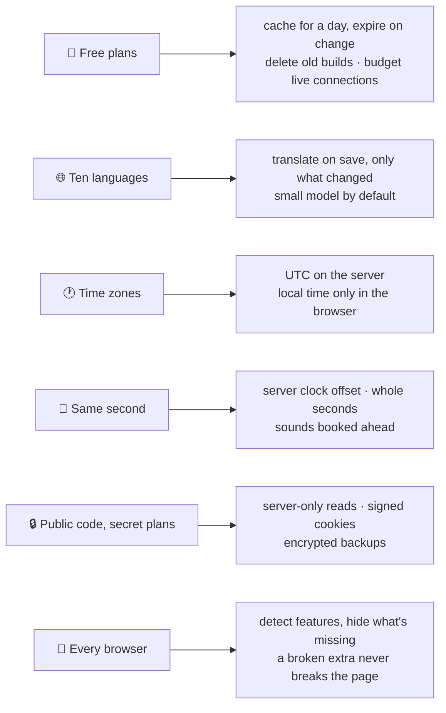

import { Aside, LinkCard } from "@astrojs/starlight/components";
import OneMinute from "../../../components/OneMinute.astro";
import TryIt from "../../../components/TryIt.astro";
import QA from "../../../components/QA.astro";
import CodeLink from "../../../components/CodeLink.astro";

<OneMinute>
Six problems explain most of the code's shape: staying inside free plans, translating ten languages without a big AI bill, showing the right time to players in every time zone, landing many players' rallies in the same second, keeping secrets in public code, and never breaking a page because one browser lacks a feature. Each section is a short story: the problem, the fix, the lesson. Learn them as stories; that's how you'll tell them.
</OneMinute>

## 1. Staying inside free plans

**The problem.** Every hosted service meters something. Vercel counts **ISR writes**: each time a cached page is rebuilt, in every language. Its free plan allows 200,000 a month. With pages refreshing every five minutes, the first week alone used 65 % of the month. Builds are about 150 MB each and the free storage is 10 GB. Supabase's free Realtime allows 200 open connections, and Rally Sync opens one per browser.

**The fix.** Pages are cached for a day and thrown away *the moment their content changes* (every save expires its cache tag), so the daily refresh is only a safety net. A workflow deletes old builds after every deployment. Rally Sync's room limits are the owner's setting, but the settings form refuses any combination that could add up to more than 180 browsers, and the database itself refuses the 181st.

**The lesson.** Measure before you trust a default. "Refresh every five minutes" sounded harmless until the bill's meter said otherwise.

## 2. Ten languages without a big AI bill

**The problem.** Every text must exist in ten languages, and moderators edit text often. In October 2026 the AI bill reached about $50 in a few days: every changed row was translated by the largest model, and bulk updates sent hundreds of rows.

**The fix.** Translation runs only when English text is saved, never when a page is viewed. Each row stores a fingerprint (hash) of every column's English text, so only the column that changed is sent. Every AI job now defaults to the small, fast model (Claude Haiku), and a bigger one is a setting, not the default. A glossary fixes the game's terms, and a monthly review in Claude Code corrects what the machine gets wrong.

**The lesson.** Cost is a design input. The cheapest request is the one you don't send, and the second cheapest goes to the smallest model that does the job.

## 3. The right time in every time zone

**The problem.** Players live in many time zones. Vercel renders pages in UTC; the browser lives in the player's zone. If the server writes "Saturday" and a browser in Seoul, where it's already Sunday, writes "Sunday", React finds two different pages and fails with hydration error #418. Worse, this only shows in production.

**The fix.** Anything in the server's HTML is formatted in UTC. Local times, countdowns and "tomorrow" appear only once the page runs in the browser (a small hook, `useNow()`, returns nothing until then). The browser tests run in three far-apart time zones, so a mismatch fails a test before it reaches players.

**The lesson.** Code that "works on my machine" can depend on where the machine is. Test from somewhere else on purpose.

## 4. The same second, on everyone's phone

**The problem.** Rally Sync tells each rally leader when to start so all rallies land together. Phone clocks drift by seconds, networks add delay, and the game has its own clock.

**The fix.** Every refresh of a room also returns the server's time, and the page computes its offset from it. Countdowns tick on corrected whole seconds. Warning sounds are scheduled ahead on the browser's audio clock, so a busy phone doesn't play them late. A leader can nudge their device's view to match the game clock (up to a minute either way). Live updates arrive as content-free pings over Realtime; the page then fetches the state, so there's one source of truth. And the server code sits in Frankfurt next to the database, so a Re-sync doesn't lose seconds crossing the Atlantic.

**The lesson.** Distributed timing is about agreeing on one clock, not about making every clock right.

## 5. Secret plans in public code

**The problem.** The code is public on GitHub, but the battle plan must not reach an enemy kingdom, and the owner's identity must not reach the players.

**The fix.** No secret is in the code: keys live in Vercel and GitHub settings. The battle-plan tables have no public read rule at all; the server reads them with its secret key only after checking a signed cookie, and the password itself never reaches a page component. Wrong guesses are throttled per address and alert the council. The weekly backup is encrypted (AES-256-GCM) before it's stored. Translation corrections for battle texts are kept outside the repository. And nothing on the site links to the repository or names its owner.

**The lesson.** "Public code" and "private data" can coexist if the boundary is enforced in the database and on the server, never by hoping nobody looks.

## 6. Every browser, or hidden

**The problem.** Players use whatever phone they have. In October 2026 the guided tours crashed into the error page on Android: Android labels its voices `en_US`, the read-aloud code passed that label to `Intl`, the browser's language API, which only accepts `en-US`, and the exception took the whole page down.

**The fix.** A rule: anything beyond plain HTML (speech, keeping the screen awake, sounds, the clipboard, newer date features) is detected before use and guarded. If a browser can't do it, its button doesn't show; if it fails, the feature goes quiet and the page stays. The tour is wrapped in its own error boundary that closes the tour instead of the page. The browser tests run a phone-sized Chrome and Safari's engine (WebKit, as on iPhones) on every change.

**The lesson.** An extra feature must never be able to break the main one. Isolate it, and decide in advance what failure looks like.

<Aside type="tip" title="Telling these stories">
Use the same four beats every time: the situation, the problem (with a number if you have one), what you did, what you learned. Two minutes each. Interviewers remember a story with a number in it: 65 % in a week, about $50 in a few days, one crash on Android.
</Aside>

## Where to look in the code

- <CodeLink path="next.config.ts" />: the one-day cache profile (`cacheLife`).
- <CodeLink path="src/lib/translate/hash.ts" />: the fingerprints that decide what gets translated.
- <CodeLink path="src/components/time/useNow.ts" />: the hook that keeps local times out of the server's HTML.
- <CodeLink path="src/lib/rally-sync/clock.ts" />: the server clock offset.
- <CodeLink path="src/lib/rally-sync/capacity.ts" />: the room limits and the 180-browser budget.
- <CodeLink path="src/lib/kvk/access.ts" />: the battle pages' signed cookies.
- <CodeLink path="src/components/tour/" />: the tours and their error boundary.

<TryIt>
Open <CodeLink path="playwright.config.ts" /> and find the three test devices. Which time zone does each one run in, and why are they so far apart? Then open <CodeLink path="src/components/time/useNow.ts" /> and find what it returns before the page is running in the browser.
</TryIt>

## Interview questions

<QA q="Tell me about a time you had to reduce costs.">
Pick one of two. **Caching:** pages refreshed every five minutes in ten languages, and after one week we had used 65 % of the month's page-write allowance. I changed the cache to one day and made every content change expire its own cache tag, so pages are still fresh the moment something changes and the timer is only a safety net. **AI:** the translation bill reached about $50 in a few days because every row went to the largest model; I switched every AI job to the small model by default, translated only the columns whose English changed, and the bill fell to cents.
</QA>

<QA q="What was the hardest bug you fixed?">
The time-zone hydration error is a good one, because it only happened in production: the server rendered dates in UTC, browsers in their own zone, and around midnight they disagreed about the day, so React threw error #418. The fix was a rule (UTC on the server, local time only after hydration) plus browser tests that run in three far-apart time zones so it can't come back. The Android tour crash is a good second: one browser's voice label crashed the page, which led to the "detect, guard, hide" rule for every optional browser feature.
</QA>

<QA q="How do you keep secrets safe when the code is public?">
Nothing secret is in the repository: keys are environment variables in Vercel and GitHub. Sensitive tables have no public read policy, so even the browser key can't read them; the server reads them after checking a signed cookie. Backups are encrypted before they're stored. And the site never links back to the repository or its owner.
</QA>

<QA q="What would you do differently next time?">
Measure the free-plan meters from day one instead of after the first surprise: both the cache refresh and the AI model choice were reasonable guesses that the bills corrected. And write the browser tests earlier: the full suite on three devices arrived at the end of the first week, and some of the bugs it found would have been cheaper to catch on day two.
</QA>

## Read more

<LinkCard title="Incremental Static Regeneration" description="Vercel docs: how cached pages are rebuilt, and what counts as a write." href="https://vercel.com/docs/incremental-static-regeneration" />
<LinkCard title="hydrateRoot" description="React docs. Read “Handling different client and server content”: the time-zone problem, from React's side." href="https://react.dev/reference/react-dom/client/hydrateRoot#handling-different-client-and-server-content" />
