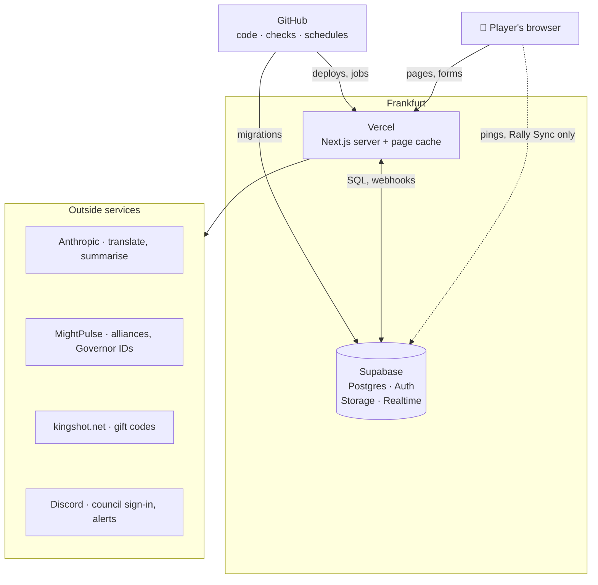
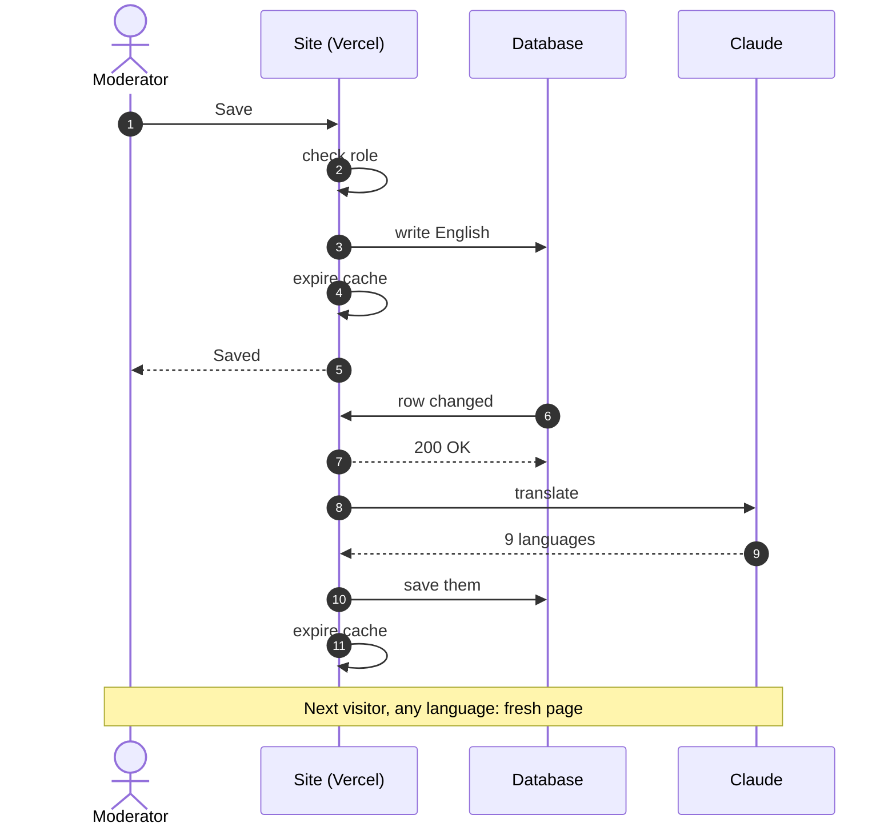

import { Aside, LinkCard } from "@astrojs/starlight/components";
import OneMinute from "../../../components/OneMinute.astro";
import TryIt from "../../../components/TryIt.astro";
import QA from "../../../components/QA.astro";
import CodeLink from "../../../components/CodeLink.astro";

<OneMinute>
Vercel runs the site's code and keeps copies of its pages; Supabase keeps the data, the council's sign-in, the images and Rally Sync's live pings. Both sit in Frankfurt, next to each other. Anthropic's Claude translates and summarises. MightPulse and kingshot.net supply game data. Discord signs the council in and receives alerts. GitHub holds the code and runs every scheduled job. The browser talks to the site; the site talks to everything else, so no secret ever reaches a browser.
</OneMinute>

## The map

## Each piece in one line

| Piece | What it does for this site | Why it's this one |
| --- | --- | --- |
| **Vercel** | Builds the Next.js app, serves pages from its CDN, runs the server code (pages, Server Actions, the five API routes) in Frankfurt. | Made by the authors of Next.js; free plan for hobby projects; a preview site for every pull request. |
| **Supabase** | Postgres for all data (33 tables), Auth for the council's Discord sign-in, Storage for editor images, Realtime for Rally Sync's pings. | A real Postgres database with sign-in and storage included, on a free plan. |
| **Anthropic** | Claude Haiku translates every text into the other nine languages and summarises battle feedback on request. Google's Gemini can stand in. | Good translation quality at about a dollar a month. |
| **MightPulse** | Game statistics: the alliances' power, leaders and members (daily), and whether a Governor ID exists (feedback form). | It already collects the kingdom's numbers and offers them through an API with a key. |
| **kingshot.net** | A fan site's list of working gift codes, read once an hour. | Free, no key, already maintained. |
| **Discord** | The council signs in with it, and alerts (like many wrong passwords) go to a council channel. | The kingdom already lives there. |
| **GitHub** | The code, the pull requests, the checks on every change, and the schedules: hourly gift codes, daily alliance sync and clean-ups, weekly backup. | Free for a public repository, including the machines that run the jobs. |

## Three rules for who talks to whom

1. **The browser talks only to the site.** Pages, forms and the Rally Sync room's state all come from Vercel. The one exception: a Rally Sync page opens a Realtime connection straight to Supabase, and that connection carries only "something changed" pings, never data. The page then asks the site for the new state.
2. **Secrets stay on the server.** The Supabase secret key, the Anthropic key and the MightPulse key exist only in Vercel's settings (and GitHub's, for the jobs). The code is public; it reads keys from environment variables.
3. **Calls between services are signed.** When the database tells the site "this row changed", or GitHub asks it to sync the alliances, the request carries a shared secret (`TRANSLATE_WEBHOOK_SECRET`). Anything without it is refused.

## One edit, followed through

What happens when a moderator saves an announcement in English:

Three details worth noticing:

- **Steps 4 and 11 throw the cached page away.** Without them, players would see the old text for up to a day. Part 7 explains this cache.
- **Step 7 answers before the translation runs.** The database shouldn't wait for an AI. The site finishes the work after replying (Next.js's `after()`).
- **If the AI is down,** the request is tried up to four times with growing pauses. If it still fails, the English text is already live and every language falls back to it until a later run fills the gap. Nothing breaks.

## Why Frankfurt

A single page or action often makes several database calls one after the other. A Rally Sync Re-sync makes about eight. When the code ran in Vercel's default region on the US east coast, every call crossed the Atlantic to the database, and a Re-sync lost about two seconds of the safety margin it gives rally leaders. Moving the code next to the database (`fra1`, Frankfurt) fixed it. The rule since then: the two always move together.

<Aside type="tip" title="Where's the region in a response?">
Every response from Vercel carries an `x-vercel-id` header like `arn1::fra1::…`. The first part is the CDN location nearest the visitor (Stockholm here), the second the region where the code ran.
</Aside>

## Where to look in the code

- <CodeLink path="vercel.json" />: the region, one line.
- <CodeLink path="src/lib/supabase/" />: the two database clients. `public.ts` uses the publishable key (published content only), `admin.ts` the secret key (server only).
- <CodeLink path="src/lib/translate/provider.ts" />: picks Anthropic, Gemini or "off", and retries.
- <CodeLink path="supabase/webhooks.sql" />: the triggers that call the site when a content row changes.
- <CodeLink path="src/app/api/translate/route.ts" />: the other end of those triggers.
- <CodeLink path="src/lib/alerts.ts" />: the Discord alert, about thirty lines.
- <CodeLink path="src/lib/rally-sync/realtime.ts" />: the small Realtime client that only listens for pings.

<TryIt>
1. Open <CodeLink path="vercel.json" />. That one line is the whole "why Frankfurt" story.
2. Open the live site in Chrome, open the developer tools (<kbd>F12</kbd>), go to **Network**, reload, click the first request and find the `x-vercel-id` response header. Which CDN location served you?
3. Open <CodeLink path="src/app/api/translate/route.ts" /> and find the line with `after(`. Everything inside it runs after the database already got its answer.
</TryIt>

## Interview questions

<QA q="Walk me through your architecture.">
"The browser talks to a Next.js app on Vercel. Vercel serves cached pages from its CDN and runs the server code in Frankfurt, next to a Supabase Postgres database, which also handles the council's Discord sign-in, image storage and Realtime pings for the live tool. When text is edited, a database trigger calls the site, which translates it with Claude and refreshes the cache. Game data comes from two outside APIs, and GitHub Actions runs the scheduled jobs, like the hourly gift-code check and the weekly encrypted backup." Draw the map from this chapter while you say it.
</QA>

<QA q="Why doesn't the browser read the database directly? Supabase allows that.">
It could, for public content, with the publishable key and row-level security. But the locked battle plans have no public read rule at all: they're read only on the server, after the password check, with the secret key. Keeping every read on the server also means one place to cache, log and check access, and the browser downloads less code. The single exception is Rally Sync's Realtime connection, which carries content-free pings; the data itself still comes through the site, behind the room's cookie.
</QA>

<QA q="What happens when one of your outside services is down?">
Each one fails soft. Anthropic down: the English text is live, the other languages fall back to English until a later run. MightPulse down: Home keeps yesterday's alliance numbers, the owner can correct them by hand, and the feedback form lets players type their name instead of blocking them. kingshot.net down: the gift codes stay as they were; the job only reports failure after six hours. Supabase down: public pages still come from the cache, and the content loaders fall back to the bundled starter content rather than an error page; the locked battle pages say there's no plan instead of showing placeholder content as if it were real.
</QA>

<QA q="Why does the database call your site, instead of the admin form translating directly?">
Because text can change in more than one way: the admin forms, a seed run, a restore from backup, or a manual fix in the database. A trigger on the table catches all of them, so translation can never be forgotten. It also keeps the save fast: the moderator gets "Saved" immediately, and translation happens in the background.
</QA>

## Read more

<LinkCard title="after()" description="Next.js docs: how a route answers first and finishes its work afterwards (step 7 of the diagram)." href="https://nextjs.org/docs/app/api-reference/functions/after" />
<LinkCard title="Row Level Security" description="Supabase docs. Read “Bypassing Row Level Security”: why the secret key must never reach a browser." href="https://supabase.com/docs/guides/database/postgres/row-level-security#bypassing-row-level-security" />
<LinkCard title="Regions" description="Vercel docs: what a region is and how the region list maps to cities." href="https://vercel.com/docs/regions" />
