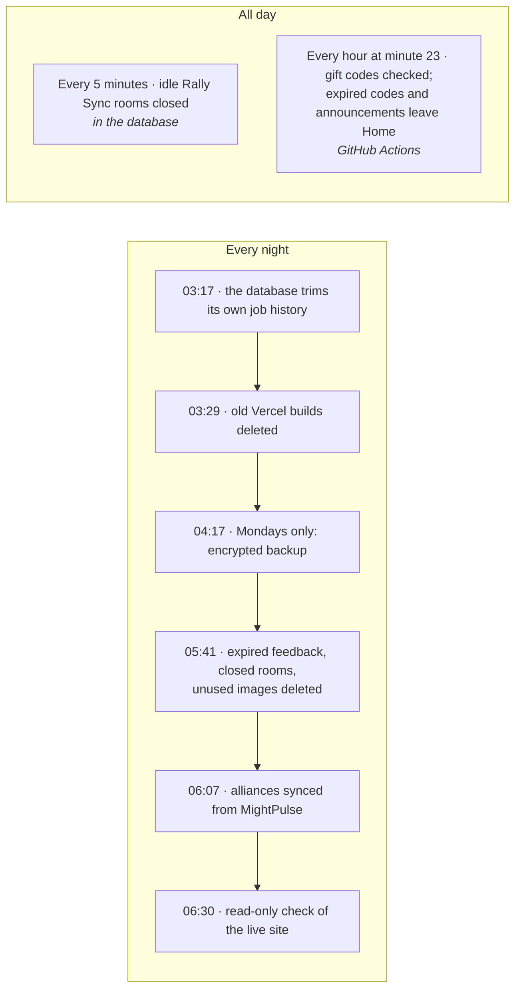
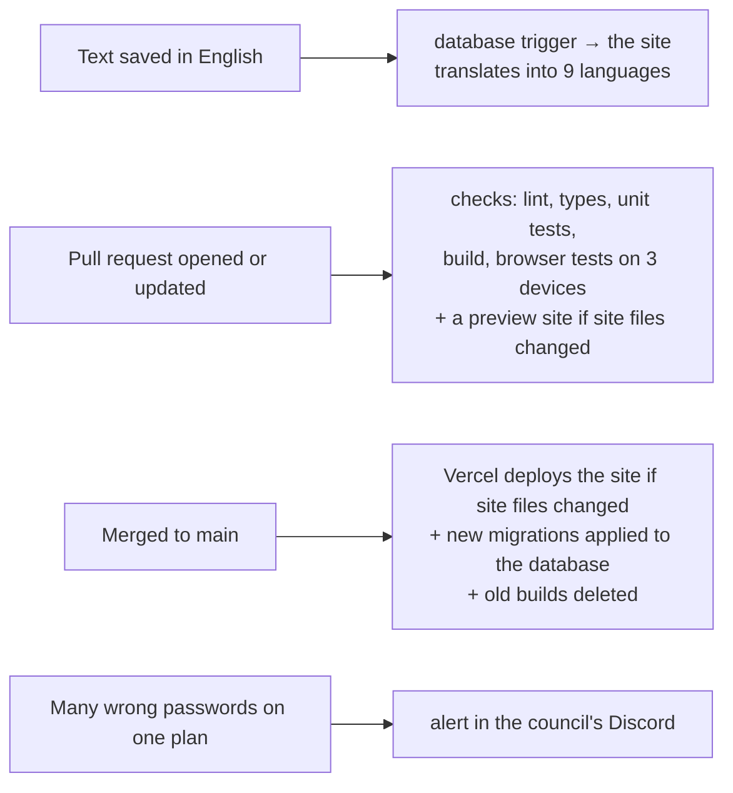

import { Aside, LinkCard } from "@astrojs/starlight/components";
import OneMinute from "../../../components/OneMinute.astro";
import TryIt from "../../../components/TryIt.astro";
import QA from "../../../components/QA.astro";
import CodeLink from "../../../components/CodeLink.astro";

<OneMinute>
A lot happens without anyone pressing a button. On a clock: every five minutes the database closes idle Rally Sync rooms; every hour GitHub checks the gift codes; every night old builds, expired feedback and unused images are deleted, the alliances are synced and the live site is checked; every Monday all content is backed up, encrypted. On events: saving text triggers its translation, a pull request triggers the checks and a preview, and a merge deploys the site and the database changes.
</OneMinute>

## On a clock (UTC)

| When (UTC) | What | Where it runs |
| --- | --- | --- |
| Every 5 minutes | Close Rally Sync rooms nobody has looked at for 30 minutes, or older than a day | The database itself (pg_cron) |
| Every hour at :23 | Read kingshot.net's gift codes and update Home; take expired codes and announcements off Home | **Gift codes** workflow → the site |
| 03:17 daily | Delete the database's job history older than three days | The database (pg_cron) |
| 03:29 daily, and after every deployment | Delete old Vercel builds, keeping the live one and the one before it | **Prune deployments** workflow → Vercel |
| 04:17 Mondays | Encrypted backup of every table, kept 90 days | **Maintenance** workflow |
| 05:41 daily | Delete feedback past its retention, closed rooms, images no text uses | **Maintenance** workflow |
| 06:07 daily | Sync the alliances' names, power, leaders and members from MightPulse | **Maintenance** workflow → the site |
| 06:30 daily | Open the live site in a browser: Home in every language, the main pages, the alliances, the not-found page | **E2E live** workflow |
| Mondays | Propose package updates | Dependabot |

<Aside type="note" title="What isn't on the list">
The page cache has no job. A cached page is kept for up to a day; the first visit after that triggers a rebuild in the background. Part 7 explains why "once a day, on demand" is cheaper than a timer.
</Aside>

## Because something happened

## Why GitHub runs the clock

Vercel can run scheduled jobs too, but on its free (Hobby) plan at most once a day, at some point within the hour you choose. The gift codes need hourly checks. The backup needs somewhere to keep its encrypted file for 90 days, and some maintenance tasks need the Supabase command-line tool. GitHub Actions does all of that for free on a public repository, and every run leaves a log and a "Run workflow" button.

The jobs that change the site's data don't do it directly: they send a request to one of the site's API routes (for example `POST /api/gift-codes/sync`) with the shared secret. The site does the work with its own code, logging and cache refresh, the same way it would for a moderator pressing "Check now".

The database's own jobs (closing idle rooms) run inside Postgres with **pg_cron**, an extension that runs SQL on a schedule. No network, no secret, nothing to fail in between.

## When a job doesn't run

Scheduled jobs are not guaranteed, and the code assumes so:

- **GitHub runs schedules when it can.** Under load, an hourly job can start late or skip an hour. The gift-code run therefore looks back to where the previous run ended (up to a day) instead of assuming "one hour ago", so an expiry is never missed.
- **GitHub pauses all schedules** of a public repository after 60 days without a commit. Dependabot's weekly pull requests usually prevent that; a merged pull request restarts them.
- **pg_cron may not be available.** If the extension can't be installed, the daily prune closes idle rooms instead.
- **A failing job says so.** A job that fails turns red in GitHub and GitHub e-mails the owner. The gift-code job only fails when the site's database is the problem or kingshot.net has been unreachable for six hours; shorter outages simply retry the next hour.

## The owner's buttons

The **Maintenance** workflow also has a menu for jobs run by hand (Actions → Maintenance → Run workflow), among them: `seed` and `sync-ui` (bring starter content and interface texts into the database), `translate` (fill in missing translations), `revalidate` (refresh the cache), `backup`, `prune`, `webhooks` and `config-push` (apply the database triggers and the sign-in settings that are kept in the repository). SETUP.md explains each one.

<Aside type="danger" title="Run them in GitHub, not on your laptop">
Each of these has an `npm run` twin in `scripts/`, and those use the production keys in your `.env.local`. Use the workflow; it's logged and it's the same code.
</Aside>

## Where to look in the code

- <CodeLink path=".github/workflows/" />: every workflow, each starting with a comment that says what it does.
- <CodeLink path=".github/workflows/maintenance.yml" />: the schedules and the menu; the `TASK:` line shows how a scheduled run picks its task.
- <CodeLink path=".github/workflows/gift-codes.yml" />: the hourly job, short enough to read in full.
- <CodeLink path="src/app/api/gift-codes/sync/route.ts" />: what that job asks the site to do.
- <CodeLink path="supabase/migrations/0012_rally_sync.sql" />: the pg_cron jobs, near the end of the file.

<TryIt>
1. On GitHub, open **Actions → Gift codes** and look at the start times of the last ten runs. How regular is "every hour" really?
2. Open <CodeLink path=".github/workflows/maintenance.yml" /> and find the line starting with `TASK:`. Work out which task runs on a Monday at 04:17, and why it isn't `prune`.
</TryIt>

## Interview questions

<QA q="How do you run scheduled jobs for a serverless website?">
Two ways, depending on the job. Jobs that only touch the database run inside Postgres with pg_cron (closing idle Rally Sync rooms every five minutes). Jobs that need the site's code, an outside API or file storage run on GitHub Actions on a cron schedule: they call a protected API route of the site with a shared secret, so the work runs through the same code, logging and cache refresh as when a moderator presses the button. Vercel's own cron wouldn't do: on its free plan a job runs at most once a day.
</QA>

<QA q="What do you do about scheduled jobs that run late or not at all?">
Design each job so a late or missed run is harmless. The hourly gift-code job looks back to where the last run ended rather than "one hour ago". The daily prune also catches anything pg_cron missed. Jobs fail loudly only when something needs a person: GitHub turns the run red and e-mails the owner, and a daily read-only browser check of the live site catches a broken deploy.
</QA>

<QA q="How do you stop strangers from calling your job endpoints?">
Every route the jobs and the database triggers call requires a secret in the `Authorization` header, compared on the server; without it the answer is 401. The secret is stored in Vercel (for the site) and in GitHub's encrypted secrets (for the jobs), and never in the public code.
</QA>

## Read more

<LinkCard title="The schedule event" description="GitHub docs, section “schedule”: cron syntax for workflows and why runs can be late." href="https://docs.github.com/en/actions/reference/workflows-and-actions/events-that-trigger-workflows#schedule" />
<LinkCard title="Supabase Cron" description="Supabase's guide to pg_cron: jobs that run inside the database." href="https://supabase.com/docs/guides/cron" />
<LinkCard title="Cron jobs: usage and pricing" description="Vercel docs: the once-a-day limit of the free plan." href="https://vercel.com/docs/cron-jobs/usage-and-pricing" />
