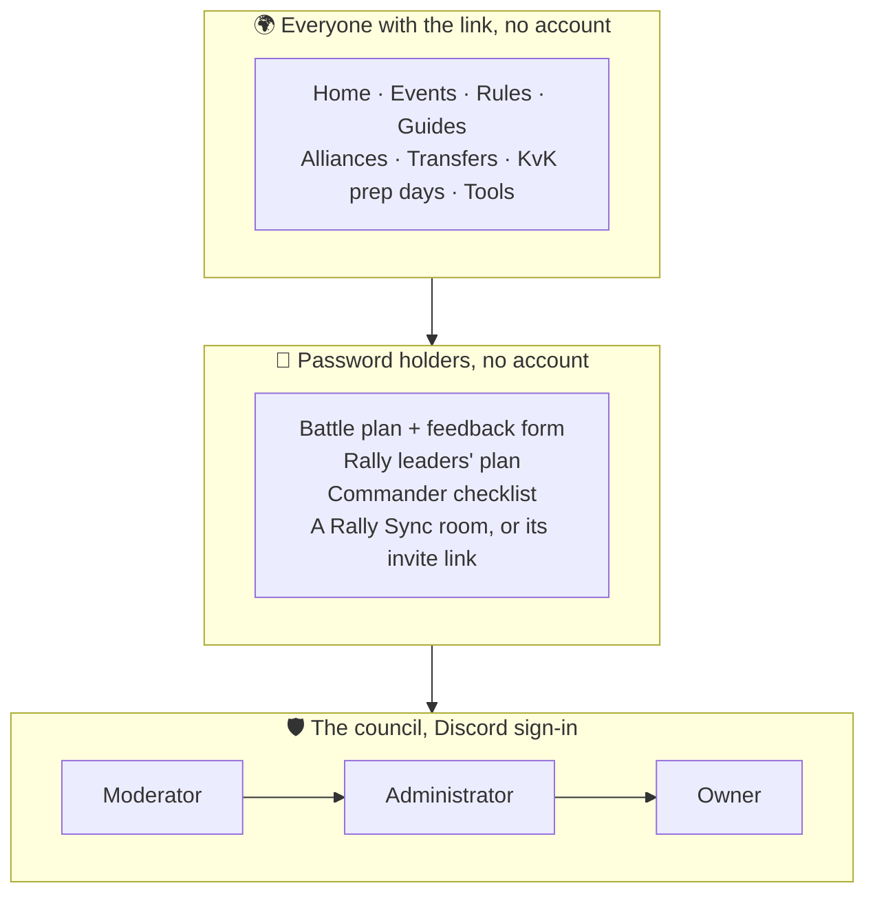

import { Aside } from "@astrojs/starlight/components";
import OneMinute from "../../../components/OneMinute.astro";
import TryIt from "../../../components/TryIt.astro";
import QA from "../../../components/QA.astro";
import CodeLink from "../../../components/CodeLink.astro";

<OneMinute>
Three layers. Anyone with the link reads the public site, in their language, without an account. Some pages open with a shared password instead of an account: the battle plan, the rally leaders' plan, the commander's checklist and each Rally Sync room. The council signs in with Discord, and a role decides what they may change: moderators edit content, administrators also manage people, and the owner alone holds the settings and appoints administrators.
</OneMinute>

## Three layers



Each layer can do everything the one above it can. The arrows inside the council mean "and also".

## Layer 1: everyone

Players never sign up. They open the link from Discord, the site picks their language from the browser (they can switch), and they read. What they choose on the site, like dark mode, a bigger text size or which tours they've seen, is stored in their own browser, not on the server.

## Layer 2: shared passwords

A battle plan has to stay away from enemy kingdoms, but an account for every player is overkill for people who just want to read it. So each locked page has **one shared password**, which the council shares with the right people (on Discord, for example):

| Page | Who gets the password |
| --- | --- |
| Battle plan (and the feedback form after the battle) | Every player of the kingdom |
| Rally leaders' plan | The players who start rallies |
| Commander checklist | The battle commander and the coordinators |
| A Rally Sync room | The players in that room (or they get its invite link) |

The right password sets a **signed cookie** in the browser, so the page stays open on that device. Change the password and every old cookie stops working: that's how a leaked password is shut off. Wrong guesses are slowed down per address ("try again in …"), and many wrong guesses on one plan alert the council on Discord. Part 8 shows how the cookie is made.

<Aside type="note" title="No two pages share a password">
The editor refuses to give the leaders' plan or the checklist the same password as the battle plan, because then every player could open the leaders' pages.
</Aside>

## Layer 3: the council

Council members sign in with **Discord**. A first sign-in creates a profile with the role **member**, which can't do anything yet; an administrator raises it, or a **pre-authorisation** made earlier (by Discord name) applies automatically.

| Can… | Moderator | Administrator | Owner |
| --- | :---: | :---: | :---: |
| Edit announcements, events, rules, guides, alliance pages | ✓ | ✓ | ✓ |
| Edit battle plans, leaders' plans, checklists | ✓ | ✓ | ✓ |
| Manage gift codes, open Rally Sync rooms | ✓ | ✓ | ✓ |
| Read, print and export feedback; delete one answer | ✓ | ✓ | ✓ |
| Appoint moderators, remove accounts | | ✓ | ✓ |
| Edit the transfer page and the Discord links | | ✓ | ✓ |
| Delete a whole plan, or all of a battle's feedback | | ✓ | ✓ |
| See who wrote which feedback; run the AI summary | | | ✓ |
| Appoint or remove administrators | | | ✓ |
| Open Settings: usage, Rally Sync limits, alliances, languages | | | ✓ |

### The owner is special

The owner isn't a row in the database. The site's settings on Vercel name one Discord user id (`SITE_OWNER`), and whoever signs in with that Discord account is the owner. That makes the top of the tree unbreakable from inside the site:

- nobody can demote or remove the owner, not even another administrator;
- nobody can change their own role;
- only the owner appoints or removes administrators;
- changing the owner needs access to Vercel's settings, not to the site.

<Aside type="caution" title="Checked twice, on purpose">
A role is checked when an admin page is drawn **and again** inside every action that changes something. Hiding a button isn't security: a request can be sent without the button. Part 8 covers why the page check alone isn't enough in Next.js.
</Aside>

## Where to look in the code

- <CodeLink path="src/lib/auth/roles.ts" />: the three roles, who outranks whom, and the rules for changing a role (`roleChangeProblem`).
- <CodeLink path="src/lib/auth/owner.ts" />: how the owner is recognised from `SITE_OWNER`.
- <CodeLink path="src/lib/kvk/access.ts" />: the signed cookies of the three locked battle pages.
- <CodeLink path="src/lib/rally-sync/access.ts" />: Rally Sync's room cookies and invite links.
- <CodeLink path="tests/lib/auth/roles.test.ts" />: the role rules, written as tests.

<TryIt>
Run the role rules' tests and read their names, which describe the rules in plain sentences:

```sh
npx vitest run tests/lib/auth/roles.test.ts --reporter=verbose
```

Then open <CodeLink path="src/lib/auth/roles.ts" />, find `roleChangeProblem`, and work out what it answers when an administrator tries to make someone else an administrator.
</TryIt>

## Interview questions

<QA q="Why shared passwords for the battle pages instead of user accounts?">
The audience is a whole kingdom of players who just need to read a plan on battle day. Accounts would mean sign-ups, password resets and personal data to protect, for a page that changes every two weeks. A shared password per page, a signed cookie per device, a throttle on guesses and an alert on many wrong tries gives enough protection against another kingdom, and a leaked password is fixed by changing it, which logs every device out.
</QA>

<QA q="How do you make sure nobody can make themselves an administrator?">
Several layers. The role lives in the database and is only changed by server actions that check the actor's role first. Nobody can change their own role. Only the owner may appoint or remove administrators, and the owner is defined in the hosting settings, not in the database, so no database change can create a second owner. Also, the user's identity is read from Discord's verified identity data, not from profile fields a signed-in user could edit themselves.
</QA>

<QA q="What's a pre-authorisation, and why have it?">
A role granted to a Discord name before that person has ever signed in. When they sign in for the first time, the grant is matched and applied, so the council can prepare a new moderator's access in advance. Grants are re-applied at every sign-in, which is why demoting or removing someone also removes their matching grants; otherwise the old role would come back on their next sign-in.
</QA>
