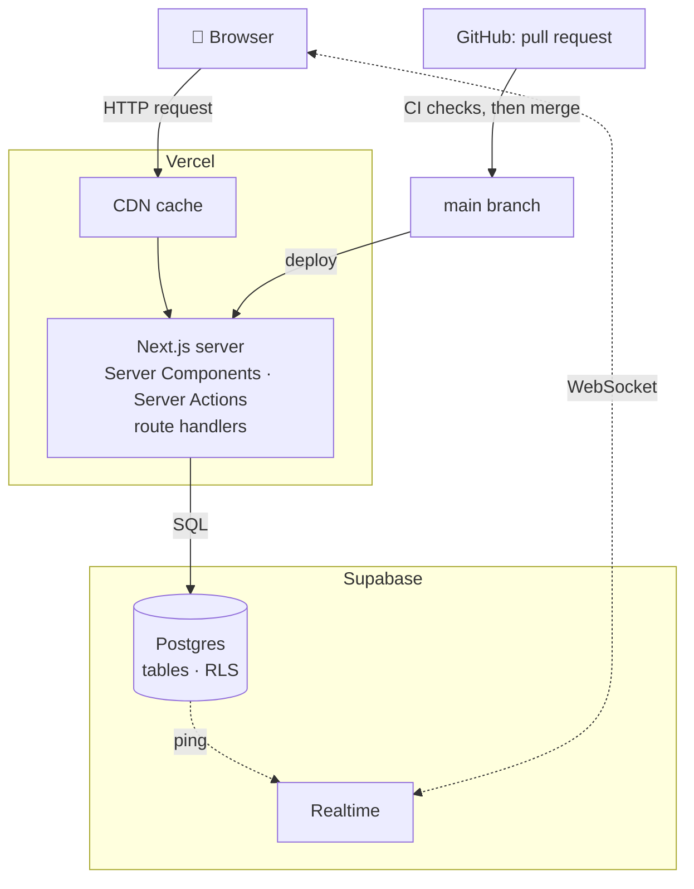

import { LinkCard } from "@astrojs/starlight/components";
import OneMinute from "../../../components/OneMinute.astro";
import TryIt from "../../../components/TryIt.astro";
import QA from "../../../components/QA.astro";
import CodeLink from "../../../components/CodeLink.astro";

<OneMinute>
The words you'll meet in this guide, grouped by topic: the game, the web, the tools this site is built with, data and security, how changes ship, testing, and languages. Each has a plain meaning and an example from this project. Skim it once now; come back whenever a chapter uses a word you don't know.
</OneMinute>

## How the main words fit together

## The game

| Word | What it means | In this project |
| --- | --- | --- |
| **Kingshot** | The mobile strategy game the site serves. | Game names and pictures belong to the game's publisher; the license says so. |
| **Kingdom** | One game server, with a number. | 1241. |
| **Alliance** | A team of players, with a short tag such as `[NAM]`. | Tags are case-sensitive: `[NAM]` and `[Nam]` are two different alliances of 1241. |
| **R5 / council** | An alliance's leader / the kingdom's group of leaders. | The people who use the admin area. |
| **Castle battle** | A battle fought inside the kingdom. | Every four weeks on a Saturday, alternating with KvK. |
| **KvK** | Kingdom versus Kingdom, a battle against another kingdom. | Every four weeks; the five days before it are the **prep days**. |
| **[KvK] and [TMP]** | The two battle alliances every player joins on battle day. | [KvK] rallies the castle, [TMP] counter-rallies. They're left out of the alliance list on Home. |
| **Rally** | An attack one player starts and others join. A **rally timer** counts down, then the troops **march** and **hit**. | Rally Sync gives each rally leader a start time = hit − rally timer − march. |
| **Garrison** | Defenders stationed in a building. They **refill** it with fresh troops between enemy hits. | Garrison rooms in Rally Sync time the refills. |
| **Counter-rally** | A rally launched in answer to the enemy's, by the counter alliance. | Counter-rally rooms give a launch order so all land together. |
| **Governor ID** | A player's number in the game. | Checked against MightPulse on the feedback form. |
| **Gift code** | A code that gives free items in the game. | Home lists the working ones, read every hour from kingshot.net. |
| **Transfer** | Moving an account to another kingdom during a set window. | The Transfers page says whether it's open and on what terms. |

## The web

| Word | What it means | In this project |
| --- | --- | --- |
| **Browser** | The program that shows web pages: Chrome, Safari, Firefox. | The browser tests run Chrome and Safari's engine (WebKit). |
| **Server** | A computer that answers requests. | Vercel runs the site's server code in Frankfurt. |
| **URL** | The address of a page. | `/de/events` is the events page in German. |
| **HTTP request / response** | The browser asks (GET a page, POST a form), the server answers with a **status code** and content. | 200 = fine, 404 = not found, 403 = not allowed, 503 = try later. |
| **HTML, CSS, JavaScript** | The page's structure, its looks, and its behaviour. | Most HTML is made on the server; JavaScript only where the page has to react. |
| **JSON** | A text format for data: `{"en": "Hello", "de": "Hallo"}`. | Every translated text is stored as JSON with one key per language. |
| **API** | A way for programs to talk to each other. | The site calls Anthropic's, MightPulse's and kingshot.net's APIs, and offers five small ones of its own. |
| **Cookie** | A small value the browser stores and sends back with every request. | Unlocking a battle page sets a signed cookie, so you don't type the password again. |
| **Local storage** | Data a page keeps in the browser, on that device only. | Dark mode, text size, ticked checklist items, tours already seen. |
| **CDN** | A network of servers around the world that keeps copies of pages close to visitors. | Vercel's CDN serves the cached pages. |
| **Cache** | A stored copy that saves doing the same work again. | Pages are cached for up to a day; any edit throws the old copy away at once. |
| **WebSocket** | A connection that stays open so the server can push messages. | Rally Sync uses one to hear "something changed". |

## The tools

| Word | What it means | In this project |
| --- | --- | --- |
| **Node.js** | Runs JavaScript outside the browser. | Version 24, everywhere. |
| **npm / package** | Node's package manager / a library someone published. | `package.json` lists the site's packages. |
| **TypeScript** | JavaScript with types, checked before the code runs. | Every source file is `.ts` or `.tsx`. |
| **React** | A library for building pages out of **components**: functions that return a piece of the page. | `<BattleCountdown />` is a component. |
| **Next.js** | A framework on top of React: routing, server rendering, caching. | Version 16, with its App Router: a folder per page in `src/app/`. |
| **Server Component** | A React component that runs only on the server. Its code never reaches the browser, so it may read the database. | Most pages. |
| **Client Component** | A component marked `"use client"` whose code is sent to the browser, so it can react to taps and keep state. | Countdowns, forms, Rally Sync rooms: 87 files. |
| **Hydration** | The browser's React taking over the HTML the server sent, attaching the click handlers. | If server and browser draw different HTML (say, another date), hydration fails: error #418. |
| **Server Action** | A server function a form can call directly. | Every admin save is one. |
| **Route handler** | A file that answers a URL with data instead of a page. | `src/app/api/…/route.ts`, five of them. |
| **Prerendering** | Making a page's HTML at build time instead of per request. | Public pages are prerendered in every language. |
| **ISR** | Incremental Static Regeneration: a prerendered page is rebuilt later, when it's stale or expired. Each rebuild is an **ISR write**, which costs money. | The reason pages refresh once a day, not every five minutes. |
| **Tailwind CSS** | Styling by short class names in the markup (`p-4 text-sm`). | Version 4, with the site's colours as variables. |
| **Vercel** | The company that hosts the site. | Builds every pull request as a **preview** and `main` as production, unless only files the site doesn't use changed. |
| **Supabase** | A hosted Postgres database with sign-in, file storage and Realtime. | The site's data, admin sign-in, images, and Rally Sync's pings. |
| **PostgreSQL (Postgres)** | A relational database: data in tables, queried with SQL. | 33 tables. |
| **Realtime** | Supabase's service that pushes messages to browsers over WebSockets. | Carries "this room changed" pings, never the data itself. |

## Data and security

| Word | What it means | In this project |
| --- | --- | --- |
| **Table, row, column** | A table is like a spreadsheet: rows are records, columns are fields. | `events` has a row per event; `name` is a column. |
| **SQL** | The language to read and change a database. | Migrations and triggers are written in SQL. |
| **Migration** | A file that changes the database's structure, applied once, in order. | `supabase/migrations/0001_init.sql` to `0023_…`. Never edited after it's applied. |
| **Trigger** | SQL that runs by itself when a row changes. | Saving English text triggers its translation. |
| **RLS** | Row Level Security: rules in the database that decide which rows a key may read. | The public key may read published content only. |
| **Publishable key / secret key** | Supabase's two keys: one safe for browsers (limited by RLS), one that may do anything. | The secret (service-role) key lives only on the server and in GitHub's secrets. |
| **Environment variable** | A setting given to a program from outside its code. | `.env.local` on your laptop; Vercel's and GitHub's settings in production. |
| **Secret** | A value that must never be published: a key, a password. | Never in the code, which is public. |
| **Hash** | A one-way fingerprint of some data. | Rally Sync rooms store a hash of their password (scrypt), never the password. |
| **HMAC** | A hash made with a secret key, so only the server can make a valid one. | The battle-page cookie is an HMAC of the plan and its password. |
| **OAuth** | Signing in through another service. | Council members sign in with Discord. |
| **Authentication / authorisation** | Who you are / what you may do. | Discord says who you are; your role in `profiles` says what you may do. |
| **Audit log** | A record of who changed what, when. | Every admin save writes to `audit_log`. |
| **Throttle** | Slowing down repeated attempts. | Too many wrong passwords from one address: "try again in …". |

## Making and shipping changes

| Word | What it means | In this project |
| --- | --- | --- |
| **Git / commit** | Version control / one saved step of changes with a message. | 300 commits in the first week. |
| **Branch** | A separate line of work. | Every change starts on its own branch, never on `main`. |
| **Pull request (PR)** | A request to merge a branch, where it's reviewed and checked. | The owner reviews and merges every PR. |
| **CI** | Continuous integration: checks that run on every PR. | Lint, typecheck, unit tests, build and browser tests. |
| **GitHub Actions / workflow** | GitHub's machines running a script (a workflow) on events or on a schedule. | Seven workflows: CI, database deploy, maintenance, gift codes, live check, deployment clean-up, and this guide. |
| **Cron** | A schedule written as five fields: minute, hour, day, month, weekday. | `23 * * * *` = every hour at minute 23. |
| **Deploy** | Putting a new version live. | Merging to `main` deploys the site and applies new migrations. |
| **Preview deployment** | A private copy of the site built from a PR. | Vercel comments its link on the PR. |
| **Rollback** | Going back to the previous version. | The deployment before the live one is always kept for this. |
| **Dependabot** | GitHub's bot that proposes package updates. | Grouped PRs every Monday; a major version gets a PR of its own. |
| **Artifact** | A file a workflow keeps after it ran. | The weekly encrypted backup, kept 90 days. |

## Quality

| Word | What it means | In this project |
| --- | --- | --- |
| **Lint (ESLint)** | A tool that flags suspicious or inconsistent code. | Also checks the Tailwind classes. Any warning fails. |
| **Typecheck** | TypeScript checking that every value is used as its type allows. | `npm run typecheck`. |
| **Unit test (Vitest)** | A small test of one function. | 752 of them, in `tests/`, mirroring `src/`. |
| **Browser test (Playwright)** | A test that drives a real browser through the site. | 48 tests on three devices, in `e2e/`. |
| **QA spec** | The written list of what the site must do, one ID per rule. | `docs/QA.md`, IDs like `RS-03`; every browser test names its ID. |
| **Flaky test** | A test that sometimes fails for no reason in the code. | Fixed at the cause; never retried. |

## Languages

| Word | What it means | In this project |
| --- | --- | --- |
| **i18n** | Internationalisation: building software so it can work in many languages. (18 letters between the i and the n.) | Every text the player sees comes from a dictionary or a translated column. |
| **Locale** | A language code used in the URL and the code. | `en`, `de`, `ko`, `pl`, `ar`, `tr`, `it`, `ja`, `zh-TW`, `fr`. |
| **RTL** | Right to left. | Arabic: the whole layout mirrors. |
| **Fallback** | What's shown when a translation is missing. | English, always. |
| **Machine translation** | Translation by an AI model. | Claude Haiku, run when English text is saved. |
| **Glossary (translation)** | Fixed words the translator must use for game terms. | `src/lib/translate/glossary.ts`. |
| **Seed** | Starter content bundled with the code. | The site runs on it when there's no database. |

<TryIt>
Pick five words from the tables you didn't know, and for each find one place in the code that uses it: open the repository in VS Code and press <kbd>Ctrl</kbd> + <kbd>Shift</kbd> + <kbd>F</kbd> (<kbd>⌘</kbd> + <kbd>Shift</kbd> + <kbd>F</kbd> on a Mac) to search every file. Try `"use client"`, `revalidateTag`, `createAdminClient`, `cron` and `hmac`.
</TryIt>

## Interview questions

<QA q="What's the difference between a Server Component and a Client Component?">
A Server Component runs only on the server: its code never goes to the browser, so it can read the database or use secret keys, and it adds nothing to the page's download size. A Client Component (marked `"use client"`) is also rendered to HTML on the server first, but its code is sent to the browser, which "hydrates" it so it can handle taps, keep state and use browser features. In this site most of every page is server-rendered; client components are the interactive islands: countdowns, forms, Rally Sync.
</QA>

<QA q="What is hydration, and how can it go wrong?">
The server sends finished HTML so the page shows fast; then React in the browser runs the same components and attaches event handlers to that HTML. React expects both to draw exactly the same thing. If they don't, for example because the server formatted a date in UTC and the browser in its own time zone, React reports a hydration error and redraws that part. This site avoids it by formatting server-side dates in UTC and showing local times only after the page is running in the browser.
</QA>

<QA q="Authentication versus authorisation: what's the difference, with an example from your project?">
Authentication is proving who you are; authorisation is deciding what you may do. Council members authenticate with Discord (OAuth through Supabase Auth). Authorisation is their role in the `profiles` table (member, moderator, administrator), checked again inside every admin action, not just when the page is drawn.
</QA>

## Read more

<LinkCard title="How the web works" description="MDN, start to end. The clearest short explanation of browsers, servers, requests and responses." href="https://developer.mozilla.org/en-US/docs/Learn_web_development/Getting_started/Web_standards/How_the_web_works" />
<LinkCard title="HTTP: an overview" description="MDN. Read the section “HTTP Messages”: what a request and a response actually contain." href="https://developer.mozilla.org/en-US/docs/Web/HTTP/Guides/Overview#http_messages" />
<LinkCard title="Server and Client Components" description="Next.js docs. Read “When to use Server and Client Components” first; the rest when you reach Part 5." href="https://nextjs.org/docs/app/getting-started/server-and-client-components#when-to-use-server-and-client-components" />
<LinkCard title="TypeScript in 5 minutes" description="The TypeScript handbook's quick tour for people who know a little JavaScript." href="https://www.typescriptlang.org/docs/handbook/typescript-in-5-minutes.html" />
