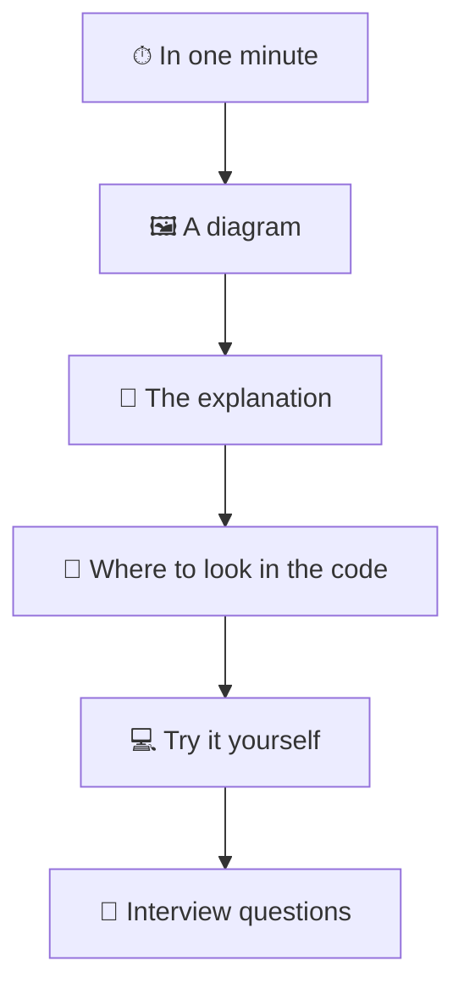

import { Tabs, TabItem, Aside, Steps } from "@astrojs/starlight/components";
import OneMinute from "../../../components/OneMinute.astro";
import TryIt from "../../../components/TryIt.astro";
import QA from "../../../components/QA.astro";
import CodeLink from "../../../components/CodeLink.astro";

<OneMinute>
This guide explains the Kingdom 1241 website to someone who knows a little programming and nothing about this project. Every chapter has the same shape: a summary like this one, a picture, the explanation, links into the code, a small exercise and interview questions. Read the summaries for the outline, the chapters for the detail.
</OneMinute>

## Who this is for

You can write "hello world" in some language. You may not yet know what a server component, a database migration or a cache tag is. That's fine: every word like that is explained the first time it matters, and the [glossary](/kingdom-1241/start-here/glossary/) has all of them in one place.

The goal is that you can **explain the whole site in your own words**: what it does, how the parts fit together, why each choice was made, and what you'd change next. That is exactly what an interviewer wants to hear about a project on your CV.

## The shape of every chapter

- **In one minute**: the chapter squeezed into a paragraph. If you only have ten minutes, read the summaries of ten chapters.
- **A diagram**: the picture comes first, because a picture of the moving parts is easier to remember than a paragraph about them.
- **The explanation**: short sections, plain words. When a topic is too big for one chapter (Postgres, React, HTTP), you get the part you need and a link to a good reference, with the section to read.
- **Where to look in the code**: links that open the exact file on GitHub. A test in the site's own test run fails when one of those files moves, so the links stay correct.
- **Try it yourself**: a small thing to do on your laptop. None of them changes the live site.
- **Interview questions**: questions an interviewer might ask about that chapter. The answer is folded away. Say your answer out loud first, then open it and compare.

## Three ways through the guide

<Tabs>
  <TabItem label="Interview tomorrow">
    <Steps>
    1. Read [the project in one minute](/kingdom-1241/start-here/the-project/) twice, until you can say it without looking.
    2. Read [six hard problems](/kingdom-1241/big-picture/hard-problems/). These are the stories interviewers remember.
    3. Go through the interview questions of every finished chapter, answer out loud, then check.
    </Steps>
  </TabItem>
  <TabItem label="I want to change something">
    <Steps>
    1. Read [the pieces and how they talk](/kingdom-1241/big-picture/the-pieces/), so you know which service is involved.
    2. Read the chapter of the feature you're changing (Part 10, once it's written).
    3. Read "How a change ships" (Part 13) before you open a pull request.
    </Steps>
  </TabItem>
  <TabItem label="I want it all">
    Read in order. Each part builds on the one before, and the sidebar's "Next" button at the bottom of each page takes you through.
  </TabItem>
</Tabs>

## A few conventions

- **Times are in UTC** unless a chapter says otherwise. The game runs on UTC, and so do the site's servers.
- **Diagrams keep their size.** On a phone, a wide one scrolls sideways inside its box.
- **"The owner"** is the person who set the site up and holds its keys: you. It is also a role in the code, with powers no one else has (Part 2 explains the roles).
- **File paths** start at the top of the repository, like <CodeLink path="src/proxy.ts" />.
- **Dates matter.** The guide describes the code as it is in the commit you're reading. When the code changes, the chapter that explains it changes in the same pull request, by rule.

<Aside type="danger" title="One rule before you try anything">
Never run the scripts in `scripts/` (like `npm run translate`, `npm run backup` or `npm run prune`) on your laptop to "see what they do". They read `.env.local`, which holds the production keys, so they act on the real database. Every "Try it yourself" in this guide is safe; anything else, read first.
</Aside>

<TryIt>
1. Open the repository in VS Code and open <CodeLink path="CLAUDE.md" />. It's long: just read the headings. It is the project's rulebook, the instructions every change (by a person or by Claude) has to follow.
2. Press <kbd>Ctrl</kbd> + <kbd>K</kbd> (<kbd>⌘</kbd> + <kbd>K</kbd> on a Mac) in this guide and search for "hydration". Search works across every chapter.
</TryIt>

## Interview questions

<QA q="Tell me about a project you're proud of.">
Keep it to three parts. **What:** a live website for the players of one kingdom of a mobile strategy game, in ten languages, with password-locked battle plans and a tool that makes many players' attacks land in the same second. **How:** Next.js on Vercel and a Postgres database on Supabase, designed to fit free plans, with AI translation that runs only when text changes. **Proof it works:** about 750 unit tests and 144 browser tests on three devices run on every change. Then stop and let them pick what to dig into. The [next chapter](/kingdom-1241/start-here/the-project/) has the details.
</QA>

<QA q="How do you get to know a codebase you didn't write line by line?">
Start from the outside: what does it do for its users, which services does it talk to, where do requests enter. Then follow one request all the way through (for this site: a visitor opening a page, Part 5). Then read the rules the project sets for itself (here CLAUDE.md) and the tests, which say what the code must do. Only then read individual files, starting from the ones the tests point at.
</QA>
