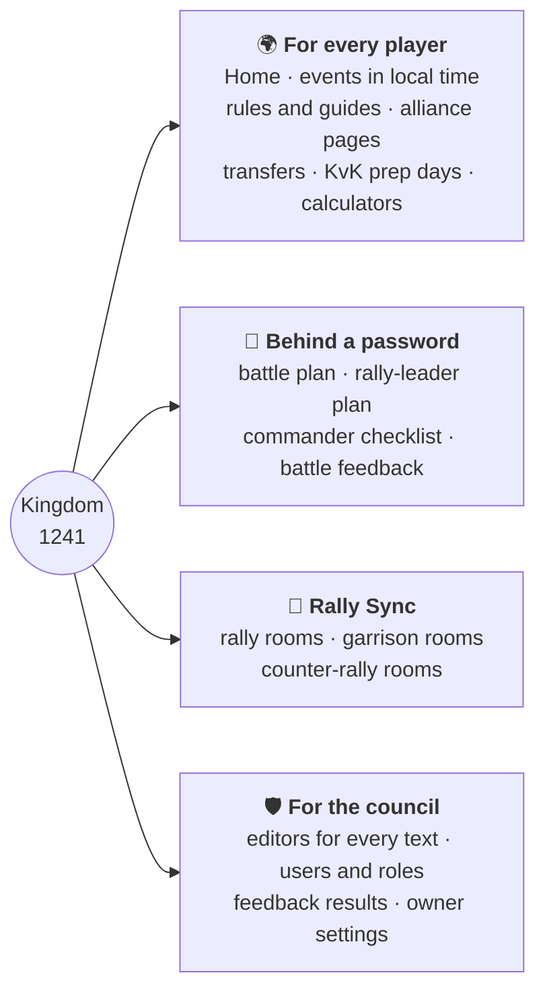

import { Card, CardGrid, Aside } from "@astrojs/starlight/components";
import OneMinute from "../../../components/OneMinute.astro";
import TryIt from "../../../components/TryIt.astro";
import QA from "../../../components/QA.astro";
import CodeLink from "../../../components/CodeLink.astro";

<OneMinute>
Kingdom 1241 is one server of the mobile strategy game Kingshot. Its players live in many countries and speak many languages. The website is their shared notice board and toolbox: rules, events in each player's own time zone, guides, gift codes, password-locked battle plans and Rally Sync, a tool that makes many players' attacks land in the same second. It works in ten languages, is built for phones first, and was designed to run on free hosting plans.
</OneMinute>

## The game in ninety seconds

You don't need to play Kingshot to understand the code, but a few words help.

- A **kingdom** is one game server, with a number. This one is 1241.
- Players group into **alliances**, each with a short tag in brackets like `[NAM]`. Alliance leaders form the kingdom's **council**.
- Every second Saturday there is a big battle. The **castle battle** is fought inside the kingdom; **KvK** (Kingdom versus Kingdom) is fought against another kingdom. The two alternate, so each comes every four weeks.
- The main attack is a **rally**: one player starts it, others join, a rally timer counts down, then the troops march. Defenders refill their garrison between two hits, so rallies that land in the same second leave them no gap. That is the reason Rally Sync exists, and its garrison rooms help the kingdom's own defenders use the gaps when the enemy's rallies don't land together.

## What the site does



<CardGrid>
  <Card title="For every player" icon="open-book">
    Home with announcements, alliances and working gift codes; events shown in the visitor's own time with countdowns; rules; guides with a tab per alliance; the five KvK prep days; two calculators. No login, ever.
  </Card>
  <Card title="Behind a password" icon="padlock">
    The battle plan, the rally leaders' plan and the commander's checklist each have their own shared password, so an enemy kingdom can't read them. After a battle, players rate it on a feedback form.
  </Card>
  <Card title="Rally Sync" icon="rocket">
    Rooms where each rally leader gets their own start time so all rallies land together. Garrison rooms time the defenders' reinforcements between enemy hits; counter-rally rooms give a launch order.
  </Card>
  <Card title="For the council" icon="setting">
    An admin area behind Discord sign-in: editors for every text on the site, the battle plan editor, users and roles, feedback results, and the owner's settings.
  </Card>
</CardGrid>

## The constraints that shaped everything

Most design decisions in this codebase come from one of these five. When something looks over-engineered, ask which one it serves.

| Constraint | What it means in practice |
| --- | --- |
| **Free plans** | Vercel, Supabase and the AI bill all have limits. Pages are cached for a day, old builds are deleted, AI runs only when text changes, and the database enforces room limits. |
| **Ten languages** | Every word a player sees is translatable. Arabic reads right to left. Translation happens when text is saved, never when a page is viewed. |
| **Phones first** | Most players open the site on a phone, often next to the game. Everything is tested at 390 pixels wide, at the largest text size, in German (the longest words). |
| **Secrecy** | Enemy kingdoms must not read the battle plan. Locked pages are read with a server-only key after a password check; the code is public, so no secret is ever in it. |
| **Privacy** | Players never sign up. The owner's real identity never appears on the site. |

## In numbers

As of 30 October 2026, one week after the first commit:

| | |
| --- | --- |
| Languages | 10: five with hand-written interface text, five machine-translated and reviewed |
| Public pages | 15 (each in every language) |
| Admin pages | 30 |
| API routes | 5 |
| Database tables | 33, built up by 23 migration files |
| Interface strings | about 820, each in every language |
| Code | about 46,000 lines of TypeScript in 362 files |
| Unit tests | 752, in 120 files |
| Browser tests | 48 tests, each run on 3 devices: 144 |
| Commits | 300, in 66 merged pull requests |

<Aside type="note" title="How it was built so fast">
The site was written with Claude Code, an AI coding assistant, as the pair programmer. The owner set the goals, made the product decisions, wrote down the rules every change must follow (<CodeLink path="CLAUDE.md" />), and reviewed and merged every pull request. The tests and the QA spec are the guardrails that make that pace safe. Be ready to talk about this openly in an interview: it is a real, current skill.
</Aside>

## Where to look in the code

- <CodeLink path="README.md" />: what's live, the stack, and a one-line description of every folder.
- <CodeLink path="docs/PLAN.md" />: the product plan, what's done and what's still open.
- <CodeLink path="src/app/[locale]/" />: one folder per page of the site.

<TryIt>
1. Open <CodeLink path="docs/PLAN.md" /> and find the section **Phases**. Which features are still open?
2. In the terminal, at the top of the repository, count the pages yourself:

   ```sh
   find "src/app/[locale]" -name page.tsx | wc -l
   ```

   You'll get 46: the 15 public pages, the 30 admin pages, and one catch-all page that turns any unknown address into the "not found" page.
</TryIt>

## Interview questions

<QA q="Describe the project in thirty seconds.">
"A website for one kingdom of the mobile game Kingshot: rules, events in each player's time zone, guides, password-locked battle plans and a tool called Rally Sync that makes many players' attacks land in the same second. It's in ten languages with AI translation, built with Next.js on Vercel and Postgres on Supabase, designed to fit free plans, and covered by unit tests and browser tests on three devices."
</QA>

<QA q="Why build a website instead of using the kingdom's Discord?">
Discord stays the place to talk. The site does what a chat can't: one tidy, current place for rules and guides instead of pinned messages; event times shown in each player's own time zone with countdowns; every text in the player's own language; tools that calculate live (Rally Sync, the calculators); and battle pages that open with a password, without players needing accounts.
</QA>

<QA q="What constraints shaped your design, and give an example of each?">
Free hosting plans (pages cached for a day instead of five minutes, because every refresh costs page writes), ten languages (translation runs when text is saved, never when a page is viewed), phones first (every page tested at 390 pixels and 125 % text size), secrecy (battle plans are only read on the server after a password check) and privacy (players never sign up; the owner's identity never appears on the site).
</QA>

<QA q="You built this with an AI assistant. What was your part?">
Deciding what to build and what not to; the product decisions (for example that a plan stays active while its feedback form is open, or that a leader added mid-rally waits for the next one); writing the rules every change must follow; reviewing every pull request; and insisting on tests and a written QA spec, so that speed never meant guessing. The assistant typed most of the code; I owned what it does and whether it's right.
</QA>
